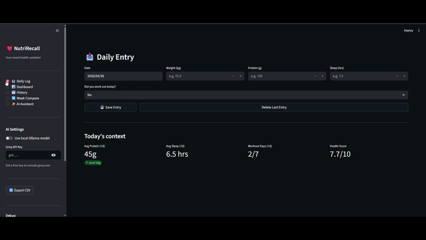
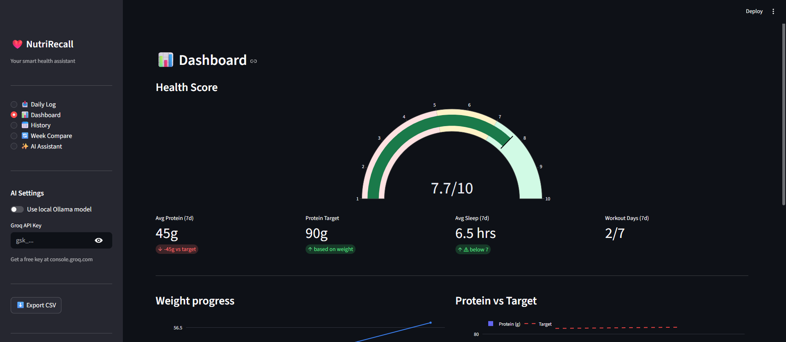
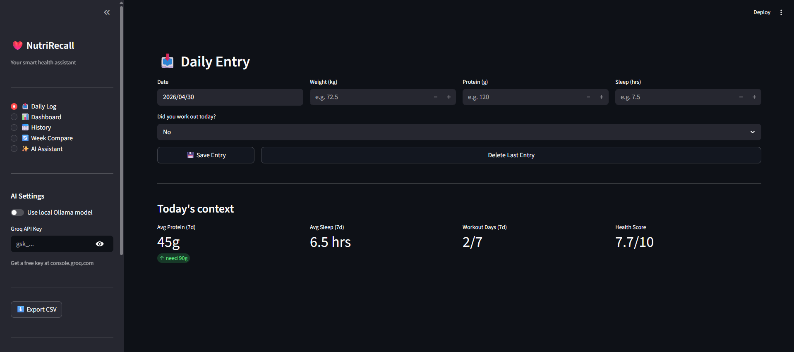
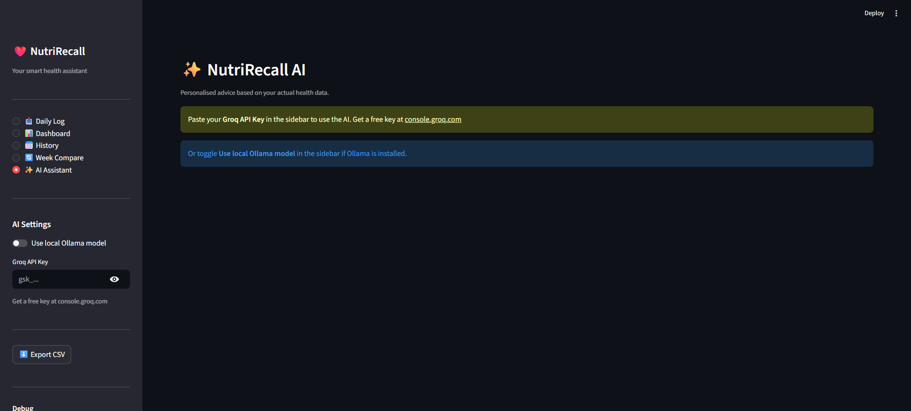
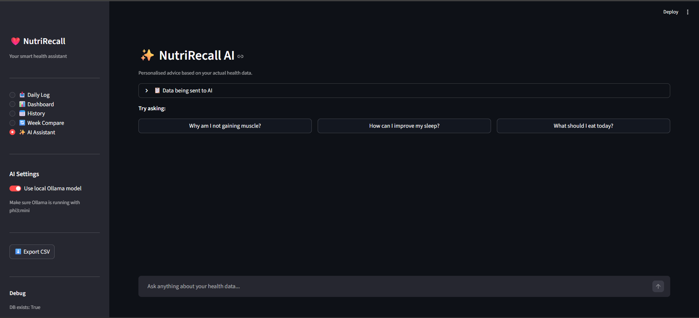

<div align="center">

# NutriRecall

### Personal Health Tracking & AI-Assisted Analysis

**Log your health. Explore your patterns.**

</div>

## What is NutriRecall?

NutriRecall is a local Streamlit prototype for logging weight, protein, sleep hours, and workouts, with SQLite storage, charts, and an AI assistant.

**Current status:** semantic RAG is connected to a single Streamlit chat, with recent logs included by default and bounded current-session follow-ups. Health guidance uses indexed source text and food-list selections with citations and qualifications; personal figures are calculated by code. **It remains experimental:** evidence selection and answer completeness can fail. The notebook preserves earlier experiments; separate live evaluation artifacts are retained locally and are not included in this checkpoint.

## Demo

<p align="left">
  
</p>

## The Problem It Solves

NutriRecall brings daily health logs, trends, and AI-assisted discussion into one interface. It is an educational prototype, not a diagnostic tool; AI responses can contain unsupported claims.

## Working App Features

| Feature | Current behaviour |
|---------|-------------------|
| Daily Logging | SQLite storage; one entry per date; positive weight, non-negative protein, and sleep between 0 and 24 hours |
| Dashboard | Week/Month/Year/All time browsing; filtered charts, recorded-day averages, logging coverage and score gauge |
| History | View records and edit them through a separate form; confirmation required for deletion |
| Week Compare | Compare two rolling seven-day periods; missing periods do not produce improvement deltas |
| AI Assistant | One chat with recent logs by default, bounded session context, expandable sources/evidence, and Groq or configurable local Ollama; optional curated guidance under sidebar Help & safety |
| Export | Download saved SQLite records as CSV |

Dashboard weeks run Monday–Sunday and initially show the latest logged week, capped at today. Previous/Next buttons and a date picker support historical browsing; future periods are disabled. Current-period coverage counts only through today. Week/Month charts show daily readings; Year uses monthly averages with logged-day counts on hover. All time uses monthly averages for spans longer than 366 days. Recorded zeros count; unlogged days remain unknown.

## Quick Start

Run commands from the repository root. Example setup using Conda and Python 3.11:

```powershell
git clone https://github.com/Sneha-pixel21/NutriRecall.git
cd NutriRecall
conda create -n NTR python=3.11
conda activate NTR
python -m pip install -r requirements.txt
python -m streamlit run app.py
```

If the repository and NTR environment already exist, skip cloning and environment creation. Streamlit and the semantic-retrieval dependencies are included in `requirements.txt`.

Open [http://localhost:8501/](http://localhost:8501/), or the URL printed by Streamlit if another port is selected. The app creates `data/health_logs.db`; it does not use the prototype CSV as its storage backend.

### AI setup and environment variables

Open **AI settings & data sharing** in the sidebar to set the provider, key, log sharing and seven-day reporting window. Logs are included by default; disabling sharing starts a new conversation. The chat also works without health records. First use of chat retrieval may download MiniLM and initialize its local index; ordinary tracking pages do not load it.

| Mode | Configured model | Setup |
|------|------------------|-------|
| Cloud | `openai/gpt-oss-20b` via Groq | Keep the local toggle off and paste a Groq API key into the settings expander |
| Local | Configurable tag; defaults to `phi3:mini` | Install/start Ollama and its Python client (`python -m pip install ollama`), enable the local toggle and enter an installed tag from `ollama list` |

Cloud requests send the question, retrieved public evidence, eligible log-field names and up to three completed conversation turns (6,000 characters maximum) to Groq. The default selection call does not receive fresh log values; code renders those figures locally. Earlier session replies can contain prior figures, but are not factual evidence or authoritative records. Standalone model-backed questions use one selection call. Context-dependent follow-ups can add one reference-resolution call; a conservative local gate skips it for clearly standalone questions, even with history. Clear, read-only log summaries and confirmed curated guidance use zero model calls. No automatic review, repair, retry or model switch occurs. Keep credentials and personal logs out of commits.

Read-only refresh questions can retain the requested fields from a preceding bounded user request when the reference is clear. Changing the selected reporting window recomputes all values; earlier assistant figures are never reused as data. An intervening unrelated topic breaks this direct refresh route.

The prototype notebook can use `GROQ_API_KEY` from `.env`:

```env
GROQ_API_KEY=your_key_here
```

Use `.env.example` as a template. **The Streamlit entry point does not currently load `.env` automatically and requires the sidebar key for cloud model requests**, even though the response helper also supports an environment-variable fallback.

Rate-limit errors show the failed pipeline step and provider-reported numeric counters when available. Retry durations are provider estimates from the failed request, not guaranteed reset times. Exact account limits can be checked in [Groq Limits](https://console.groq.com/settings/limits); allowances apply across the organization. No automatic retry or model switch is performed by the app.

## Architecture

Current app:

```text
Streamlit → SQLite logs → scoring and summary
Explicit read-only log summary → code-rendered averages, dates and coverage (no model)
Question + bounded session context → resolve only contextual/uncertain references
         → fresh knowledge retrieval → one Groq / Ollama evidence-selection call
         → code validation and source rendering
         + relevant recorded figures, dates and coverage rendered locally
Sidebar Help & safety → explicit confirmation → curated warning (no model call)
```

The app no longer calls the legacy TF-IDF or Chroma summary-memory helpers. Those helpers remain in `utils/ai.py` for compatibility. Chat context stays in the current Streamlit session; **New conversation** clears it. There is no permanent conversation or vector memory. Only public knowledge resources are cached; private summaries and API keys are not cached with them.

The score weights protein/sleep/workout as 40%/30%/30%, scaled to 1–10, with a protein target of weight × 1.6 g/kg. These are app heuristics, not validated medical assessments or universal nutrition prescriptions.

Personal summaries report the exact window, logged dates and coverage; averages include recorded zeros but do not impute missing days. Unsupported requests should abstain even with logs attached. Citation IDs and source/item indices are checked separately; valid selections do not establish relevance or completeness. The model selects evidence rather than writing health claims. Code renders source text or food-list subsets, preserving protein/calorie relationships and source qualifications. General health guidance retains its passage context, at the cost of a less conversational answer.

For explicit mixed-log requests, a separate recorded-data block retains requested recorded-day figures and coverage even when the model omits log fields. General guidance remains separate; athlete status and personal targets are not established by these logs. The code does not calculate new personalized deficits or targets. Recognized requests for unavailable periods or statistics show the available coverage and explain the scope limitation instead of substituting current averages. Broader phrasing and the local reference gate remain imperfect; some questions still require clarification or an unnecessary resolution call. Review details record the route and model stages used.

In the AI Assistant sidebar, expand **Help & safety**, select **Sudden or unexplained weight loss**, then confirm **Show curated guidance**. This displays the existing cited warning without a model call or API key; cancellation leaves ordinary chat unchanged. This optional help is not automatic symptom detection or a general medical-safety system.

Groq calls use a **10-second timeout setting per API call**, with automatic retries disabled. A multi-call answer can take longer overall; this is not a ten-second deadline for the complete conversation request. Timeouts show a retry message and do not reset rate limits. Local Ollama timeout behaviour is unchanged.

Per-response disclosure distinguishes record fields rendered in the answer from a fresh summary sent to the model. Merely having a prepared summary does not create a “Logs used” card. Prior session text may contain earlier figures independently of the fresh-summary attachment. Older response snapshots without usage tracking are labelled as such.

### File structure

```text
NutriRecall/
├── app.py                         # Working Streamlit app
├── requirements.txt
├── .env.example
├── .streamlit/config.toml         # Streamlit visual theme
├── utils/
│   ├── db.py                      # SQLite CRUD and CSV export
│   ├── ai.py                      # Scoring, summaries and grounded generation
│   ├── rag.py                     # Knowledge retrieval and evidence formatting
│   ├── dashboard.py               # Calendar periods, coverage and chart aggregation
│   ├── grounding.py               # Bounded context, evidence review and rendering
│   └── evidence.py                # Source units and qualified food-list selections
├── notebooks/
│   ├── NeutriRecall.ipynb          # CSV-based prototype
│   ├── OLD_nutrirecall.ipynb       # Archived earlier prototype
│   └── RAG_Development.ipynb       # Experimental semantic retrieval
├── knowledge_base/
│   └── nutrition_v1.json          # 16 curated passages and citations
├── tests/
│   ├── test_ui_baseline.py         # Mock-storage UI regression tests
│   ├── test_dashboard.py           # Synthetic period, navigation and aggregation tests
│   ├── test_rag_pipeline.py        # Offline pipeline checks
│   ├── test_grounding.py           # Provenance, rendering and session checks
│   ├── test_evidence.py            # Source-selection contract and rendering checks
│   ├── test_comparison.py          # Call counts and comparison safeguards
│   ├── test_streamlit_rag.py       # Mocked Streamlit/RAG integration tests
│   ├── test_request_flow.py        # Request routing and model-call checks
│   └── rag_cases.json             # 10 evaluation cases
├── assets/                        # Demo and screenshots
├── scripts/evaluate_rag.py         # Opt-in live evaluation with synthetic logs
├── scripts/compare_rag.py          # One-case single-selection vs review comparison
├── evaluation/                    # Local evaluation outputs; not included in this checkpoint
├── data/                          # Local SQLite DB; existing health_logs.csv
└── chroma_db/                     # Generated local vector stores
```

## Notebooks and Experimental RAG

| Notebook | Role |
|----------|------|
| [NeutriRecall.ipynb](notebooks/NeutriRecall.ipynb) | CSV-based prototype for scoring, summaries, placeholder TF-IDF retrieval, and local/API model calls. Separate from the SQLite app; review optional append/model/legacy-memory cells before running. |
| [OLD_nutrirecall.ipynb](notebooks/OLD_nutrirecall.ipynb) | Archived earlier notebook with legacy experiments and model settings; reference material, not the recommended entry point. |
| [RAG_Development.ipynb](notebooks/RAG_Development.ipynb) | Experiment/evaluation record for retrieval, API generation, citation checks, explicit safety routing, and synthetic log summaries. Reusable functions have been extracted into `utils/rag.py` and `utils/ai.py`; the notebook is not needed to run Streamlit. |

For notebook work, install the additional tools in the same environment and select the NTR kernel:

```powershell
python -m pip install notebook ipykernel ipywidgets sentence-transformers langchain-chroma langchain-huggingface
python -m ipykernel install --user --name NTR --display-name "Python (NTR)"
python -m notebook
```

The RAG notebook locates the repository from the current working directory; start Jupyter from the repository root or `notebooks/` directory. The Python modules use project-relative paths. The embedding model is `sentence-transformers/all-MiniLM-L6-v2` (384 dimensions), downloaded on first use and run locally. Knowledge vectors are stored under `chroma_db/knowledge_minilm_v1`, separately from the unused legacy summary-memory store. Remaining notebook outputs are historical; live API cells were not rerun after the path and error-handling edits.

### Curated knowledge base

[nutrition_v1.json](knowledge_base/nutrition_v1.json) contains **16 source-backed, paraphrased passages**: four each for protein, sleep, physical activity, and healthy weight gain. Each passage carries population qualifications, limitations, and a citation with source name, URL, section, and checked-on date.

Sources are NIH ODS, CDC, WHO, and NHS. The NHS passages preserve a warning that the page's displayed next-review date was overdue when checked. This is general educational material, not personal health data or individualized medical advice.

### Retrieval evaluation progress

Verified against **saved notebook outputs**, not a new evaluation run:

- With the provisional wider-retrieval settings, all expected passages were retrieved in **8 of 8 development cases requiring passages**; the unrelated development query returned no matches.
- The personal-summary case in [rag_cases.json](tests/rag_cases.json) is skipped by retrieval evaluation and checked separately using synthetic data. Its dates, coverage, zero values, and reporting header have now been tested.
- Four additional query checks retrieved the weight-loss warning and rejected the router and migraine-medication requests. The exercise paraphrase retrieved only one of two expected passages; the aerobic passage was just beyond the cutoff.
- Broader retrieval also includes less relevant passages. The sudden-weight-loss warning ranked sixth for one development question. Finding a warning does not prove an answer will prioritize it.
- The saved full-answer batch output was cleared during notebook cleanup. No aggregate answer pass count is claimed from the current notebook. Individual examples remain; separate historical evaluation artifacts are retained locally. Citation-ID validity does not establish claim support.
- Settings remain provisional. These small, inspected cases do not establish generalization, clinical safety, or universal citation faithfulness. Detailed distance/cutoff experiments stay in the notebook.

The current Python pipeline differs from the saved notebook baseline: indexed evidence selection is followed by code-based validation and rendering, rather than unrestricted health paraphrasing. Same-model review remains an explicitly requested evaluation option. The live runner records development cases, additional paraphrases, unrelated requests with synthetic logs, and session follow-ups. Outputs require manual assessment; neither a model review nor passing mock tests establish grounding quality. Evaluation scripts are included; their generated reports are not required to run the app or offline tests.

**Live acceptance is partial.** Earlier local runs exposed relevance, completeness and provider failures. The current single-selection default, mixed-log retention and selective routing have offline verification only and have not been live revalidated. Historical reports are retained locally and are not shipped as reproducible acceptance evidence in this checkpoint. Source review status is rendered separately so the NHS qualification is retained.

**Next work:** finish remaining UI and AI acceptance checks, then learn Docker and prepare deployment. Live AI testing is currently paused. Recheck source review status before release.

## Screenshots

Existing screenshots illustrate the prototype and may differ from the latest UI.

### Dashboard

<p align="left">
  
</p>

### Daily Logging

<p align="left">
  
</p>

### API vs local LLM

<p align="left">
  
</p>

### AI Interface

<p align="left">
  
</p>

## Tech Stack

Working app: Streamlit, SQLite, pandas, Plotly, Sentence Transformers MiniLM, ChromaDB, LangChain integrations, and Groq/Ollama generation. scikit-learn and legacy summary-memory helpers remain for prototype compatibility.

## Tests

```powershell
python -m unittest discover -s tests -v
```

The UI regression and integration tests mock storage and model resources rather than editing real health logs or making live API calls. Pipeline tests cover summaries, provenance, extractive rendering, bounded context, routing and provider adapters. They do not establish model quality.

Opt-in live evaluation uses public passages and synthetic fixtures only, never the health database:

```powershell
python scripts/evaluate_rag.py --live --output evaluation/live_review.json
```

This runner reads `GROQ_API_KEY` from `.env` and uses cached MiniLM weights. It makes real Groq requests subject to your account limits. Inspect the saved answers against the passages and case criteria; outputs are initially marked as awaiting manual review.

**Streamlit now defaults to single selection.** The internal `review_evidence=True` option is retained for explicit evaluation; it is never an automatic fallback. Both variants use the same evidence validation and renderer, including code-owned retention of explicitly requested log fields. Explicit review can receive a relevant fresh summary; selection sees field names only. New reports carry `pipeline_version: single_default_v2`; old saved comparisons preserve the previous renderer and routing behaviour.

To compare one case deliberately, choose a new output filename:

```powershell
python scripts/compare_rag.py --live --case rag_02 --output evaluation/comparison_foods_new.json
```

This uses public passages and synthetic fixtures, an ephemeral index and cached embeddings. One ordinary pair makes three calls (one selection plus explicit selection/review); contextual history cases share one additional resolution call. Standalone questions skip that resolution. Cases include `rag_05`, `rag_06`, `rag_09`, `plant_followup`, `mixed_logs` and `unconfirmed_warning`. `--first review` reverses variant order for another run. The runner refuses existing output files, stops on errors and never retries automatically.

Reports record per-stage attempts, timings and provider-reported tokens (unavailable counts are null). `response_seconds` excludes pacing; stage elapsed time includes it. Retrieval/setup time is excluded. A received response is not a passing answer. Compare relevance, missing qualifications, medical boundaries, follow-ups and unsupported selections manually; same-model review is not independent factual verification. Rewriting's retrieval benefit has not been isolated experimentally.
